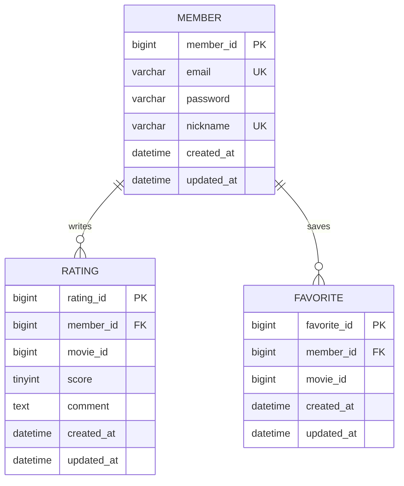

# 영화 평점 서비스 API 명세

기본 주소: `http://localhost:8080`. 영화 목록·검색·상세는 FE가 TMDB에 직접 요청한다.

## 5주차 조회 API

| 기능 | Method / URL | 요청 | 성공 응답 |
| --- | --- | --- | --- |
| 닉네임 중복 확인 | GET `/members/nickname/{nickname}` | Path: nickname(string) | 200, `{ "available": boolean }` |
| 이메일 중복 확인 | GET `/members/email/{email}` | Path: email(string) | 200, `{ "available": boolean }` |
| 회원별 평점 최신순 조회 | GET `/members/{memberId}/ratings` | Path: memberId(integer) | 200, RatingResponse 배열. 없는 회원은 404 |

RatingResponse: `ratingId: number`, `movieId: number`, `score: number`, `comment: string|null`, `createdAt: string`, `updatedAt: string`.

`available: true`는 해당 값으로 등록한 회원이 없어 사용할 수 있다는 뜻이다. 평점은 createdAt 내림차순, 같은 시각이면 ratingId 내림차순이다.

## ERD



- Rating·Favorite 각각 `(member_id, movie_id)` 복합 UNIQUE.
- movie_id는 TMDB 식별자이며 자체 movie 테이블을 참조하는 FK가 아니다.
- Favorite은 이번 주에 스키마만 생성한다.
- 스키마: `BE/movie/sql/schema.sql`, 반복 실행 가능한 추가용 시드: `BE/movie/sql/seed.sql`.
- CORS 허용 origin: `http://localhost:5173`, `http://127.0.0.1:5173`.

## 6주차 쓰기 API

| 기능 | Method / URL | Body | 성공 |
| --- | --- | --- | --- |
| 회원가입 | POST `/members` | email(string), password(string), nickname(string) | 201, ApiResponse<MemberResponse> |
| 평점 등록 | POST `/members/{memberId}/ratings` | movieId(양의 정수), score(1~5 정수), comment(선택 문자열) | 201, ApiResponse<number>, result는 ratingId |
| 평점 수정 | PATCH `/members/{memberId}/ratings/{ratingId}` | score(1~5 정수), comment(선택 문자열) | 200, ApiResponse<null> |
| 평점 삭제 | DELETE `/members/{memberId}/ratings/{ratingId}` | 없음 | 204, 응답 본문 없음 |

회원가입 검증: 비어 있지 않은 이메일(최대 254자), 닉네임 2~12자, 비밀번호 대문자·소문자·숫자·특수문자(!@#$%^&*)를 포함한 8자 이상. bcrypt 제한에 맞춰 비밀번호는 UTF-8 기준 최대 72바이트다. 서버는 bcrypt 해시만 저장하고 MemberResponse에는 memberId·email·nickname만 담는다.

평점 검증: score는 소수점을 허용하지 않으며 1~5 정수다. comment는 최대 500자다. 한 회원은 한 영화에 한 평점만 등록할 수 있다. 수정 시 score는 필수이며 comment를 생략하면 null로 바뀐다.

로그인 전인 6주차의 계약에 따라 요청 회원 ID는 Path에서 받는다. 로그인 토큰을 통한 회원 식별은 이후 주차 범위다.

### 공통 응답

```json
{
  "isSuccess": true,
  "code": "COMMON201",
  "message": "회원가입에 성공했습니다.",
  "result": { "memberId": 3, "email": "example@example.com", "nickname": "예시회원" }
}
```

위 JSON은 구조 설명용 예시다. 실제 실행 응답은 `docs/evidence/week06/api-responses.json`을 참고한다.

| 실패 | HTTP / code | result |
| --- | --- | --- |
| 입력 검증, 잘못된 JSON·자료형 | 400 / COMMON400 | null |
| 다른 회원의 평점 수정·삭제 | 403 / COMMON403 | null |
| 없는 회원·평점 | 404 / COMMON404 | null |
| 이메일·닉네임·회원/영화 평점 중복 | 409 / COMMON409 | null |

6주차 쓰기 API의 성공·오류는 `isSuccess`, `code`, `message`, `result`를 사용한다. 5주차 GET의 plain DTO·배열 계약은 유지한다. DELETE 204는 HTTP 계약에 따라 JSON 본문이 없는 예외다.
