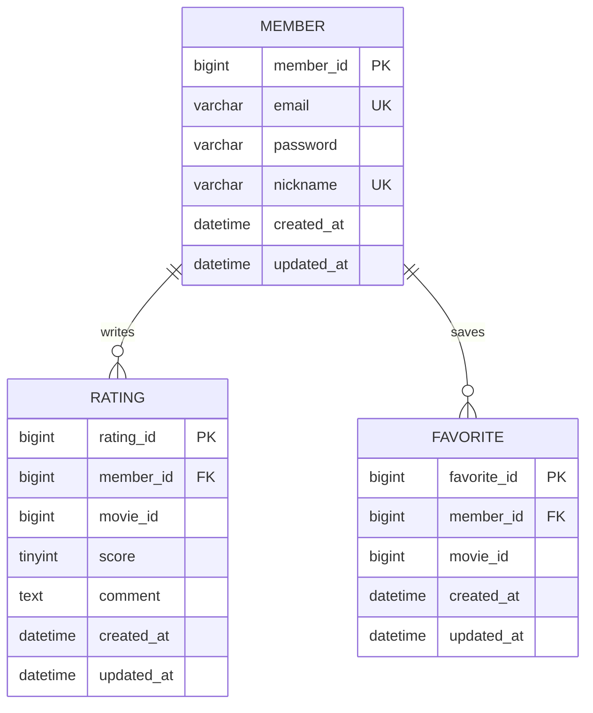

# 영화 평점 서비스 API 명세

기본 주소: `http://localhost:8080`. 영화 목록·검색·상세는 FE가 TMDB에 직접 요청한다.

## 5주차 조회 API

| 기능 | Method / URL | 요청 | 성공 응답 |
| --- | --- | --- | --- |
| 닉네임 중복 확인 | GET `/members/nickname/{nickname}` | Path: nickname(string) | 200, `{ "available": boolean }` |
| 이메일 중복 확인 | GET `/members/email/{email}` | Path: email(string) | 200, `{ "available": boolean }` |
| 회원별 평점 최신순 조회 | GET `/members/{memberId}/ratings` | Path: memberId(integer) | 200, RatingResponse 배열. 없는 회원은 404 |

RatingResponse: `ratingId: number`, `movieId: number`, `score: number`, `comment: string|null`, `createdAt: string`, `updatedAt: string`.

`available: true`는 해당 값으로 등록한 회원이 없어 사용할 수 있다는 뜻이다. 평점은 createdAt 내림차순, 같은 시각이면 ratingId 내림차순이다.

## ERD

- Rating·Favorite 각각 `(member_id, movie_id)` 복합 UNIQUE.
- movie_id는 TMDB 식별자이며 자체 movie 테이블을 참조하는 FK가 아니다.
- Favorite은 이번 주에 스키마만 생성한다.
- 스키마: `BE/movie/sql/schema.sql`, 반복 실행 가능한 추가용 시드: `BE/movie/sql/seed.sql`.
- CORS 허용 origin: `http://localhost:5173`, `http://127.0.0.1:5173`.
